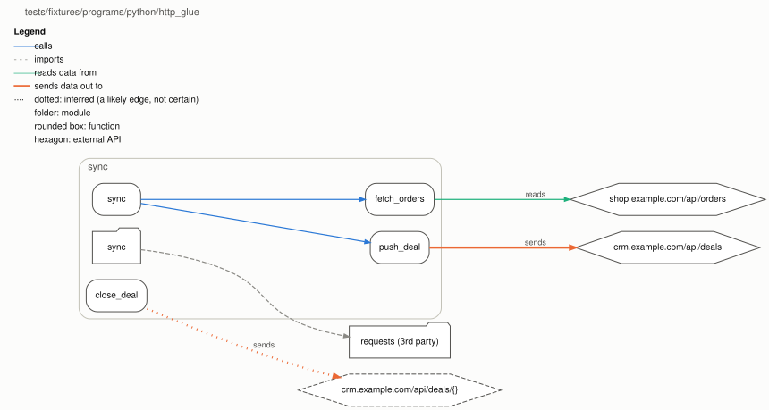

# Optum

Optum breaks software down into one graph of what it does, simplifies it, and rebuilds a company's
tool sprawl as one system the company owns. See [Optum-concept.md](Optum-concept.md) for the full
concept and [docs/ROADMAP.md](docs/ROADMAP.md) for the build plan.

Status: **v0.2 (Phases 1 and 2 done, [changelog](docs/CHANGELOG.md)); Phase 3, unifying a
company's tools, next.** `optum diagnose <dir>` reports waste (tools doing the same job, unused
code, duplicated logic, the same data in several places), and a first automatic fix merges
duplicated Python code when it's safe and the tests agree. Built-in frontends for **Python**, **JavaScript/TypeScript**, **C** and **x86-64 ELF binaries**:
`optum graph <dir>` breaks a codebase down into one graph (the Python 3.12 standard library,
285k lines, takes about 0.15 s).
Other languages and tools plug in as adapters in any language ([docs/protocol.md](docs/protocol.md));
the first one reads n8n workflows:

```sh
./build/debug/Core/optum graph tests/fixtures/programs/mixed/crm_glue \
    --adapter "python3 Core/adapters/n8n/optum_n8n.py" --level module -f svg -o overlap.svg
```

## Build

Needs GCC 13+ (C++20) and CMake 3.25+.

```sh
git clone https://github.com/Scramblehub/Optum.git && cd Optum
git submodule update --init --depth 1
cmake --preset debug && cmake --build --preset debug -j
ctest --preset debug
./build/debug/Core/optum graph .
```

Commands:

| Command | Does |
|---|---|
| `optum graph <path> [-o out] [-f json\|dot\|svg\|mermaid]` | Break code down into a graph: Python, JS/TS, C, ELF binaries, plus any adapters |
| `optum diagnose <path> [-f markdown\|json] [-o out]` | Report waste: tools doing the same job, unused code, duplicated logic, the same data in several places; with evidence and confidence ([docs/diagnose.md](docs/diagnose.md)) |
| `python3 Core/fixers/merge_duplicates.py <dir> --optum <optum> [--test cmd] [--apply]` | Merge exact duplicate Python functions and methods, only when safe and the tests agree ([docs/fixes.md](docs/fixes.md)) |
| `optum export <graph.json> [-o out.svg]` | Draw a saved graph, or cut a smaller one from it |
| `optum frontends [path] [--adapter cmd]` | List frontends and which files each would read |
| `optum syntax-tree <file>` | Developer aid: the tree-sitter syntax tree of a `.py`/`.js`/`.ts`/`.c` file |
| `optum disasm <binary>` | Research aid: an ELF binary's functions and instructions, as JSON |
| `optum check <files...>` | Validate graph files; errors name the exact field |
| `optum merge <files...> [-o out.json]` | Merge graphs by node id |
| `optum score <expected> <produced>` | Precision and recall of a produced graph against a hand-checked one |
| `optum verify <graph.json> <trace.json>` | How many calls observed at runtime the graph has ([docs/verify.md](docs/verify.md)) |
| `optum infer <recordings> [--n8n flows] -o out/` | Each tool's behaviour learned from recorded traffic: operations, callers, fields, status changes; automation flows that never ran ([testco/README.md](testco/README.md)) |
| `optum model <dir> --deployment d.json [--recordings r/] [--n8n flows/]` | What each component does to which data, and whether it could go: a class (removable, essential, unknown...) with its reasons, evidence and confidence; `--check model.json` lists conclusions whose inputs changed ([docs/plans/capabilities.md](docs/plans/capabilities.md)) |

Both `graph` and `export` take view options (`--level module`, `--focus <node>`, `--edges calls,reads`,
`--no-inferred`); see [docs/diagrams.md](docs/diagrams.md).



The graph format is documented in [docs/ir.md](docs/ir.md). Schema tests need `pip install jsonschema`.

Presets: `debug`, `release`, and `asan` (AddressSanitizer + UBSan; CI runs all three).

## Layout

| Folder | Holds |
|---|---|
| `Core/` | Optum's own source: the graph model (IR), frontends, analyses, viewer |
| `External_Libraries/` | Pinned third-party submodules; see its [README](External_Libraries/README.md) |
| `tests/` | Tests plus `tests/fixtures/`: small sample programs with known, hand-checked graphs |
| `docs/` | Roadmap, design notes, decision records |

## Working on it

See [docs/CONTRIBUTING.md](docs/CONTRIBUTING.md) for the branch and commit rules.
