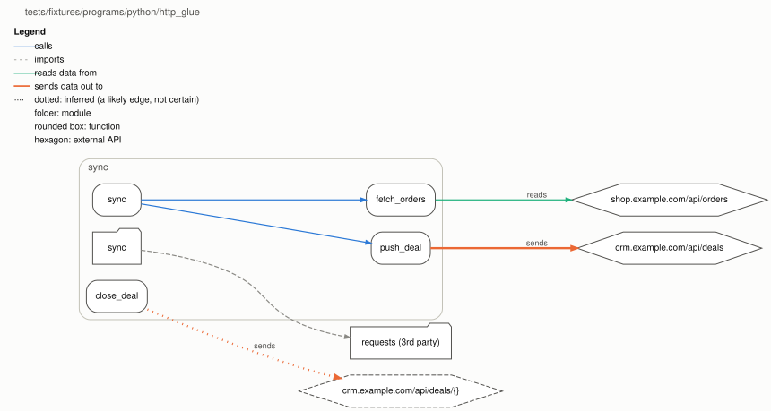

# Diagrams and views

Any graph can be drawn, or cut down to the part that answers a question.

```sh
optum graph shop/ -f svg -o shop.svg              # straight from source
optum export graph.json -o graph.svg              # from a saved graph (SVG by default)
optum graph shop/ -f mermaid > shop.mmd           # for markdown: GitHub renders it
optum graph shop/ --focus place_order --depth 2 -f svg -o order.svg
optum graph . --level module --edges imports -f svg -o deps.svg
optum graph . --edges reads,writes,sends_to -f svg -o data.svg   # only the data flows
```



## Views

A view is a smaller graph cut from a larger one. It's a valid graph, so `-f json` gives agents
and scripts the same cut a person sees in a diagram.

| Option | Does |
|---|---|
| `--level module` | Collapses everything into its module (or program, such as a workflow); parallel edges merge, with `attrs.count` (drawn as `×3`) |
| `--focus <node>` | Keeps one node, everything within `--depth` edges of it (default 1), and their modules. The node can be its full id or a unique ending (`place_order`, `Shape.area`); an ambiguous one lists the candidates |
| `--edges a,b` | Only these edge kinds. Containment (`defines`) is always kept, for grouping |
| `--no-inferred` | Leaves out guessed edges |
| `--max-nodes N` | Diagrams over 1500 nodes (300 for Mermaid) are refused with a hint, because they can't be read |

Options combine in a fixed order: edge filters first, then `--level`, then `--focus`.

## How it's drawn

Node kinds are told apart by **shape**:

| Shape | Node |
|---|---|
| rounded box | function |
| double box | class / data type |
| folder | module (when it has nothing shown inside it) |
| grey rounded frame | a module or program (e.g. a workflow), containing its functions, classes or steps |
| cylinder | data store (database table) |
| hexagon | external API |
| arrow | workflow step |
| 3-D box | program |

Edge kinds are told apart by **color, line style and label together**, so no meaning depends on
color alone:

| Edge | Drawn as |
|---|---|
| `calls` | blue line |
| `triggers` | thick blue line, labelled |
| `reads` | aqua line, labelled "reads" |
| `writes` | orange line, labelled "writes" |
| `sends_to` | thick orange line, labelled "sends" |
| `imports` | grey dashed line |
| any guessed (`inferred`) edge | dotted |

The three colors (blue `#2a78d6`, orange `#eb6834`, aqua `#1baf7a`) passed colorblind and
normal-vision separation checks for all pairs on the light background. A fourth (violet or red)
failed against one of them, which is why the remaining kinds use line style instead. Aqua is
below 3:1 contrast, so aqua edges always carry a text label. Every diagram has a legend listing
only what it contains. Diagrams are light-mode only for now.

## Limits

- SVG needs Graphviz (`dot`) installed; `-f dot` works without it.
- Big codebases make dense pictures even at module level (the `email` package: 29 modules and
  115 import and call edges). Use `--focus` and `--edges` to ask a narrower question.
- Package containment (a package and its submodules) isn't drawn as nesting yet.
