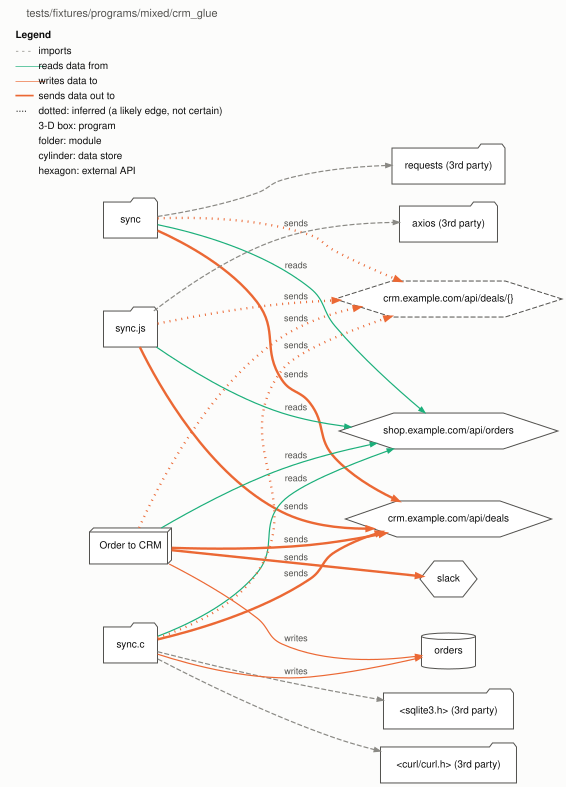

# Writing an Optum adapter (protocol 0.1)

An **adapter** teaches Optum a language or tool it doesn't know: a proprietary language, a
configuration format, a no-code workflow tool. It's a program, in any language, that reads files
and writes a graph. Optum never needs your compiler or your source format: only the graph.

A complete example is [Core/adapters/n8n/optum_n8n.py](../Core/adapters/n8n/optum_n8n.py)
(n8n workflow exports, about 200 lines of standard-library Python).

## Using one

```sh
optum graph ./repo --adapter "python3 adapters/my_adapter.py"
optum frontends ./repo --adapter "python3 adapters/my_adapter.py"   # which files it would get
```

`--adapter` can be given several times. Optum's built-in frontends (Python, JS/TS, C, ELF) always run too. All the
graphs are merged by node id.

## The two requests

Optum runs the adapter command with one extra argument.

### `describe`

No input. Print one JSON object to stdout and exit 0:

```json
{
  "protocol": "optum-frontend/0.1",
  "name": "n8n",
  "version": "0.1.0",
  "file_patterns": ["*.json"]
}
```

| Field | Required | Meaning |
|---|---|---|
| `protocol` | yes | `optum-frontend/0.1`. Optum accepts any `0.1.x` |
| `name` | yes | Short name, used in messages and as each node's `frontend` |
| `version` | no | Your adapter's version |
| `file_patterns` | yes | Glob patterns. A pattern without `/` matches the file name (`*.cob`); with `/` it matches the path relative to the root (`flows/*.json`) |

### `extract`

Optum writes a request to stdin:

```json
{
  "protocol": "optum-frontend/0.1",
  "root": "/abs/path/to/repo",
  "files": ["billing/invoice.cob", "billing/tax.cob"]
}
```

`files` are relative to `root`, use `/`, and are every file matching your patterns, except in
hidden directories, `__pycache__`, `node_modules`, `venv` and `site-packages`. A pattern like
`*.json` will also match files that aren't yours: **skip files you don't understand**, silently.

Print one graph to stdout in the [IR format](ir.md) (`ir_version` `0.1.x`) and exit 0.

## Rules

- **stdout is only the JSON answer.** Anything for people goes to **stderr**: Optum shows it,
  prefixed with your adapter's name, and leaves it out of the graph.
- **Exit 0 on success.** On any other status Optum stops and shows the last lines of stderr.
- **Time limit:** 300 seconds per request by default (`--adapter-timeout`). After that the
  adapter is killed.
- **The output is checked strictly,** like any graph: unknown fields, unknown kinds, duplicate ids
  and edges to missing nodes are errors. Validate with `optum check out.json` or the
  [JSON Schema](ir.schema.json) while developing.
- **Locations** (`loc.file`) are relative to `root`.
- **Partial analysis is fine.** Leave out what you can't work out, and say so on stderr. Mark
  anything guessed as `"confidence": "inferred"`.

## Ids: how graphs from different tools join up

Optum merges graphs by node id. Use your own namespace for your own things (`cob:`, `n8n:`), and
the **shared** namespaces for things other tools also touch, so they meet on one node:

| Thing | Id | Rule |
|---|---|---|
| An HTTP API | `http:<host><path>` | Drop the scheme, default port (`:443`, `:80`), query and fragment; lower-case the host; drop a trailing `/`; `{}` for each unknown path part. No id if the host is unknown |
| A database table | `sql:<table>` | Drop a default schema prefix (`public.`, `dbo.`, `main.`); keep others (`sales.orders`) |
| A SaaS product (no URL) | `saas:<service>` | Lower-case service name: `saas:slack`, `saas:hubspot` |

The cases in [tests/fixtures/ids/url_cases.json](../tests/fixtures/ids/url_cases.json) are the
reference. Optum's own tests check both its C++ code and the bundled adapters against them; do the
same for yours (see `tests/tools/check_shared_ids.py`).

This is what makes the unification work: in
[tests/fixtures/programs/mixed/crm_glue](../tests/fixtures/programs/mixed/crm_glue), a Python
script, a Node script, a C program and an n8n workflow call the same shop and CRM APIs, and the
merged graph shows all four pointing at the same three nodes:



## Checklist for a new adapter

1. `describe` prints the right protocol and patterns.
2. `extract` skips files that aren't yours without failing.
3. `optum check` accepts the output.
4. Shared ids match `url_cases.json`.
5. A sample in `tests/fixtures/programs/<adapter>/` with a hand-checked `expected.json`, scored in
   ctest the way the n8n one is.

## Versioning

The protocol version is `optum-frontend/MAJOR.MINOR`. While MAJOR is 0, a MINOR change may break
adapters; Optum refuses an adapter whose MAJOR.MINOR differs from its own and says which it speaks.
